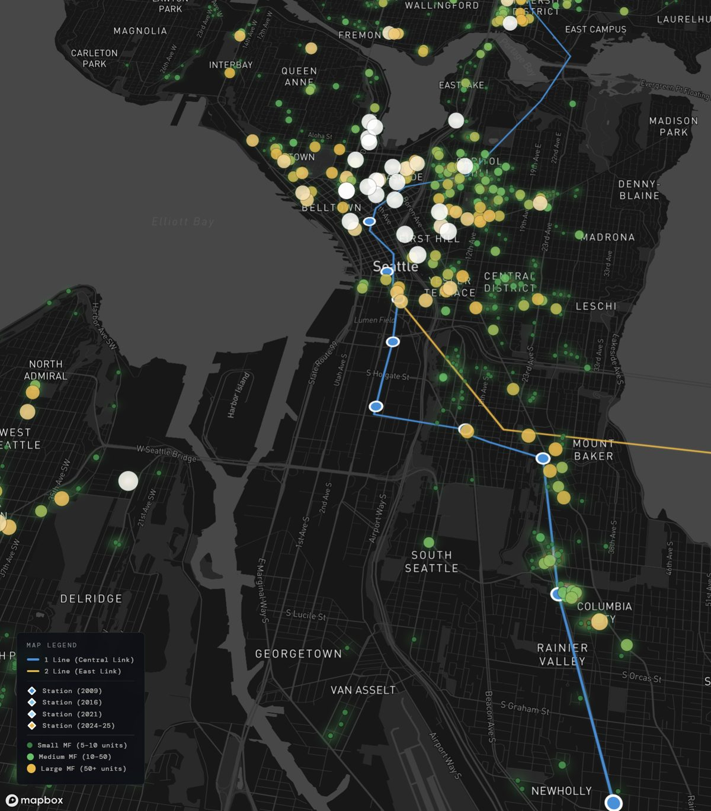

# Tracks to Tomorrow: Link Light Rail and Housing Growth in Seattle

A scrollytelling story map tracing how Sound Transit's Link Light Rail has shaped multifamily development, transit-oriented development (TOD), and rents across Seattle since 2009.

**[Live demo →](https://mfarrell-gis.github.io/seattle-link-tod-analysis/)**

## The question

Seattle has been building light rail for two decades. Has housing followed the tracks, and what has that meant for rents in the neighborhoods around new stations?

## What the map shows

The story moves through eight chapters, from the 1996 regional transit vote to the planned 2035 build-out. As the reader scrolls, stations appear in the order they opened, and housing permits appear in the years they were issued.

- **Rail network over time:** 1 Line and 2 Line alignments, with stations appearing as each segment opened
- **Housing growth:** a heatmap and unit-scaled points for 772 multifamily permits (5+ units). Click a point for its address, neighborhood, and year
- **Rent trends:** average 1-bedroom rent from 2009 to 2023 for four station-area neighborhoods, with rail opening dates marked
- **Before and after:** a drag slider comparing 2009 and 2023 rents near rail

## Data

| Dataset | Source |
|---|---|
| Multifamily housing permits, 2005–2024 | Seattle Department of Construction & Inspections (SDCI) |
| Light rail stations | Sound Transit |
| Rail line geometry | Digitized from Sound Transit system maps |
| Neighborhood rents | CoStar/BERK via the *One Seattle Plan* EIS (2023); Apartment List |

The raw SDCI extract (16,000+ residential permits) was cleaned and filtered to multifamily projects of 5+ units. The cleaned file is in [`data/`](data/). The filtered records are embedded in `index.html`, so the page needs no data requests at runtime.

Contextual claims about supply and rent, walkability, and regional demand cite the Furman Center, Pew, BLS, the Census Bureau, and Brookings/Walk Score research. Full references are in the map's closing section.

## Methods

- Cleaned the SDCI permit extract and filtered it to multifamily projects of 5+ units
- Built station and opening-date data as GeoJSON
- Digitized both line alignments from Sound Transit maps, including tunnel and surface segments
- Synced the map camera, layer visibility, and station reveals to scroll position, using Mapbox GL JS
- Built the rent chart and before/after slider in vanilla JavaScript and canvas

## Limitations

- The map shows correlation between rail and development timing, not causation. Upzoning, the regional job market, and the 2010s housing boom all overlap with station openings.
- Rent figures are neighborhood averages from secondary sources, not unit-level data.
- Permits issued are not the same as units completed.

## My role

Course project for GEOG 458 at the University of Washington (Winter 2026), assigned to a team of four. A teammate set up the repository and a starter template. I built the story map itself, including the data processing, chapter narrative, map layers and animation, rent chart, and before/after slider. Teammates then reorganized the stylesheet and made fixes to the station data and styling. The project was originally hosted on a teammate's GitHub; this copy is maintained by me.

## Tech

Mapbox GL JS · vanilla JavaScript · HTML/CSS · GitHub Pages
